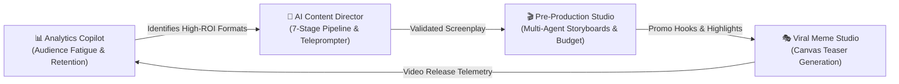

# 🎬 CineCraft OS — Autonomous Creator & Video Studio SaaS

> **The All-in-One Autonomous AI Video SaaS Platform synthesizing Video Pre-Production, 7-Stage Creative Direction, Viral Meme Marketing & Creator Analytics Intelligence.**

[](https://www.typescriptlang.org/)
[](https://reactjs.org/)
[](https://vitejs.dev/)
[](https://tailwindcss.com/)
[](https://www.python.org/)
[](https://streamlit.io/)

---

## 🌟 Executive Overview & Repository Synthesis

**CineCraft OS** unites three specialized, high-impact creator AI engines into a unified, commercial-grade SaaS product:

| # | Engine | GitHub Repository | Lead Contributor | Core Innovation |
|---|--------|-------------------|------------------|-----------------|
| **1** | **Creator Analytics Copilot** | [`bhuvanashreekr-del/ASADI_Protosem01`](https://github.com/bhuvanashreekr-del/ASADI_Protosem01.git) | **Bhuvanashree K R** | Deterministic analytics engine, Audience Fatigue anomaly detector, posting day/hour heatmaps, duration decay curves, Gemini conversational "Ask Your Data" AI, and PDF/CSV report exports. |
| **2** | **AI Content Director (CineSensei)** | [`sriclickjananii-bot/18_AI-content-director`](https://github.com/sriclickjananii-bot/18_AI-content-director.git) | **Sri Jananii S** | 7-Stage Creative Direction pipeline (Research, Angles, Narrative, Script teleprompter, Visuals, Shot list, Publishing), Viral Meme Studio with canvas rendering, and casual video simulation. |
| **3** | **AI Video Pre-Production Studio** | [`akshayam1207-oss/25_AI-Video-Pre-Production-Studio`](https://github.com/akshayam1207-oss/25_AI-Video-Pre-Production-Studio.git) | **Akshaya M** | Autonomous multi-agent pre-production planning, scene breakdowns, shot lists, camera specs, lighting setups, prop checklists, and crew/equipment budget estimation. |
| **Upstream** | **Protosem01 Cohort Hub** | [`Rishi-ZAiFi/ASADI_Protosem01`](https://github.com/Rishi-ZAiFi/ASADI_Protosem01.git) | **Rishi-ZAiFi** | Upstream repository base for the Protosem01 engineering sprint. |

---

## 🔄 Closed-Loop Creator Workflow

Unlike fragmented single-purpose tools, CineCraft OS operates as a **closed-loop feedback cycle**:



1. **Step 1 — Channel Intelligence (Analytics Copilot)**: Ingest past YouTube/TikTok/Reels data. Detect that 45s-55s short-form videos achieve 3.2x higher share velocity with 0% fatigue, while 12m+ videos suffer a 40% retention drop.
2. **Step 2 — Creative Strategy (AI Content Director)**: Generate 5 psychological angles, 3-act narrative tension, dual-column teleprompter scripts (audio vs visual action), and viral packaging.
3. **Step 3 — Autonomous Pre-Production (Pre-Production Studio)**: Split the script into scenes, camera angles (35mm f/1.8), lighting mood (45° softbox), props checklist, and crew budget.
4. **Step 4 — Viral Amplification (Meme Studio)**: Create viral promotional memes and teaser cutaways on the HTML5 canvas editor featuring comedy icons (Vadivelu) and global templates.
5. **Step 5 — Post-Release Telemetry**: Ingest real audience watch curves and restart the cycle.

---

## ⚡ The 4 Studio Engines

### 1. 🎬 Autonomous Pre-Production Studio
- **Multi-Agent Orchestrator**: Director, Screenwriter, Storyboard Artist, and Budget Estimator agents.
- **Detailed Scene Specs**: Shot-by-shot visual framing, camera movements, lens suggestions (24mm, 35mm, 50mm), composition rules, lighting mood, and audio cues.
- **Production Binders & Screenplay Export**: Export to PDF Production Binder, Fountain Screenplay, and Shot List JSON/CSV.

### 2. 🧠 AI Content Director (7-Stage Pipeline)
- **Stage 1 (Research & Facts)**: Psychological pain points, market facts, and empirical retention metrics.
- **Stage 2 (Content Angles)**: Contrarian, experiment, and story hooks with uniqueness and emotional difficulty ratings.
- **Stage 3 (Narrative Storyboard)**: Pacing curves and timecoded 3-act beat architecture.
- **Stage 4 (Spoken Script & Teleprompter)**: Two-column teleprompter pairing voiceover with on-screen visual/sound action at ~146 WPM cadence.
- **Stage 5 (Visuals & B-Roll)**: Color palette direction, B-roll stock queries, and SFX cues.
- **Stage 6 (Production Shot List)**: Check-off shot list grouped by location setup to minimize shoot time.
- **Stage 7 (Publishing & Packaging)**: A/B tested viral titles, high-contrast thumbnail concepts, and optimal posting windows.

### 3. 🎭 Viral Meme Studio & Generator
- **Interactive HTML5 Canvas Editor**: Customize top and bottom text, font sizing, color picker, and text outlines directly over templates.
- **Template Registry**: Rich collection of iconic cinema meme legends (Vadivelu, Vivek, Santhanam) and global creator memes (Drake, Distracted Boyfriend, Expanding Brain, Two Buttons).
- **One-Click Download & Attach**: Export high-resolution PNGs ready for social drops or video cutaways.

### 4. 📈 Creator Analytics Copilot
- **Data Ingestion & Normalization**: Seamlessly upload or explore demo datasets across YouTube, TikTok, and Instagram Reels.
- **Deterministic KPI Engine**: Track total views, avg engagement rate, completion hold, and click-through rates.
- **Audience Fatigue Anomaly Detector**: Identifies format saturation, diminishing returns, and duration decay before subscriber churn occurs.
- **Posting Heatmap Matrix**: Identifies peak algorithmic windows (e.g., Tuesday & Thursday 6:00 PM – 9:00 PM, Sunday 7:00 PM).
- **"Ask Your Data" AI Assistant**: Natural language conversational assistant powered by Google Gemini heuristics with direct one-click handoffs to Pre-Production.

---

## 💰 SaaS Business Model & Pricing

| Feature | **Starter ($19/mo)** | **Pro Studio ($49/mo)** *(Popular)* | **Agency Enterprise ($149/mo)** |
|---|:---:|:---:|:---:|
| **Target Audience** | Solo Creators | Growing Creators & Teams | Agencies & Media Networks |
| **Pre-Production Plans** | 10 plans / month | **Unlimited** | **Unlimited** |
| **7-Stage Content Direction** | Standard | Full with Teleprompter | Multi-Channel Tone Profiles |
| **Viral Meme Studio** | Unlimited PNGs | Unlimited PNGs | Custom Branded Watermarks |
| **Analytics Telemetry** | 1 Channel | 3 Channels + Fatigue Engine | Unlimited Channel Networks |
| **AI Data Copilot** | Basic Queries | Conversational Gemini Engine | Custom Data Webhooks |
| **Exports** | PDF & Markdown | PDF Binders, Fountain Screenplay, CSV | White-label Binders & Custom APIs |

---

## 🚀 Quick Start Guide

### Prerequisites
- **Node.js** v18+ (tested on v24.16.0)
- **npm** or **pnpm**
- **Python** 3.10+ (for optional Streamlit engine)

### Option A: Launch the Unified SaaS Web Application (Recommended)

```bash
# Clone the repository
git clone https://github.com/bhuvanashreekr-del/ASADI_Protosem01.git
cd ASADI_Protosem01

# Checkout the SaaS product branch
git checkout saas-product

# Navigate to web application directory
cd web

# Install dependencies
npm install

# Start development server
npm run dev
```

Open your browser at `http://localhost:5173` to explore the complete SaaS platform!

To build for production:
```bash
npm run build
npm run preview
```

### Option B: Launch the Python Streamlit Analytics Engine

```bash
# From repository root
cd ASADI_Protosem01
pip install -r requirements.txt
streamlit run app.py
```

---

## 📁 Repository Structure

```text
ASADI_Protosem01/
├── package.json              # Root project scripts proxy
├── requirements.txt          # Python analytics dependencies
├── app.py                    # Streamlit Creator Analytics Copilot entrypoint
├── src/                      # Python deterministic analytics modules
│   ├── ai.py                 # Gemini AI analysis & Ask Your Data engine
│   ├── analytics.py          # Deterministic KPI & pattern detection
│   ├── config.py             # Benchmarks, sample data, canonical schemas
│   ├── export.py             # PDF, CSV, and Markdown report generator
│   ├── insights.py           # Rule-based offline insights generator
│   ├── loader.py             # Multi-format data loader & validator
│   ├── mapping.py            # Platform auto-detection & column mapper
│   └── ui.py                 # Custom Streamlit UI components
├── tests/                    # Pytest test suite for Python engine
├── web/                      # 🌟 Unified Modern React SaaS Web Application
│   ├── package.json          # Vite + React 18 + Tailwind + Lucide dependencies
│   ├── vite.config.ts        # Vite build configuration
│   ├── tailwind.config.js    # Studio design system & color tokens
│   ├── index.html            # App entrypoint
│   └── src/
│       ├── App.tsx           # Global SaaS router & cross-engine state handoffs
│       ├── types/            # Unified TypeScript domain interfaces
│       ├── services/
│       │   ├── aiGenerator.ts              # Multi-agent pre-production plan synthesis
│       │   ├── contentDirectorService.ts   # 7-stage creative pipeline & mock engine
│       │   ├── memeRegistry.ts             # Viral meme templates & situation matcher
│       │   ├── analyticsEngine.ts          # TS analytics calculations & fatigue engine
│       │   └── storage.ts                  # LocalStorage project persistence
│       ├── pages/
│       │   ├── LandingPage.tsx   # SaaS landing page with live interactive engine demos & pricing
│       │   ├── DashboardPage.tsx # Centralized SaaS dashboard with 4-engine launch cards
│       │   ├── CreateProjectPage.tsx # Step-by-step project creation wizard
│       │   ├── ProjectsPage.tsx  # Project library & portfolio management
│       │   └── SettingsPage.tsx  # User preferences, API keys, and billing settings
│       └── components/
│           ├── layout/           # Navbar with studio switcher & Footer with repo links
│           ├── workspace/        # Pre-Production Studio (Scenes, shots, cameras, budget)
│           ├── contentdirector/  # AI Content Director 7-stage interactive pipeline
│           ├── memestudio/       # Interactive HTML5 Canvas Viral Meme Studio
│           └── analytics/        # Creator Analytics Copilot view & Ask Your Data chat
└── README.md                 # Complete SaaS documentation
```

---

## 👥 Contributors & Attribution

This SaaS product was engineered by uniting the strengths of three contributors during the **Protosem01 Sprint**:

- **Bhuvanashree K R** ([@bhuvanashreekr-del](https://github.com/bhuvanashreekr-del)) — Creator Analytics Copilot, Audience Fatigue Engine, Gemini Conversational AI, and Report Generation.
- **Sri Jananii S** ([@sriclickjananii-bot](https://github.com/sriclickjananii-bot)) — AI Content Director (CineSensei), 7-Stage Creative Direction Pipeline, and Viral Meme Studio.
- **Akshaya M** ([@akshayam1207-oss](https://github.com/akshayam1207-oss)) — AI Video Pre-Production Studio, Multi-Agent Planning Architecture, Scene Breakdown, and Shot Lists.
- **Rishi-ZAiFi** ([@Rishi-ZAiFi](https://github.com/Rishi-ZAiFi)) — Protosem01 Upstream Mentor and Cohort Lead.

---

## 📄 License

Distributed under the MIT License. See `LICENSE` for more information.
